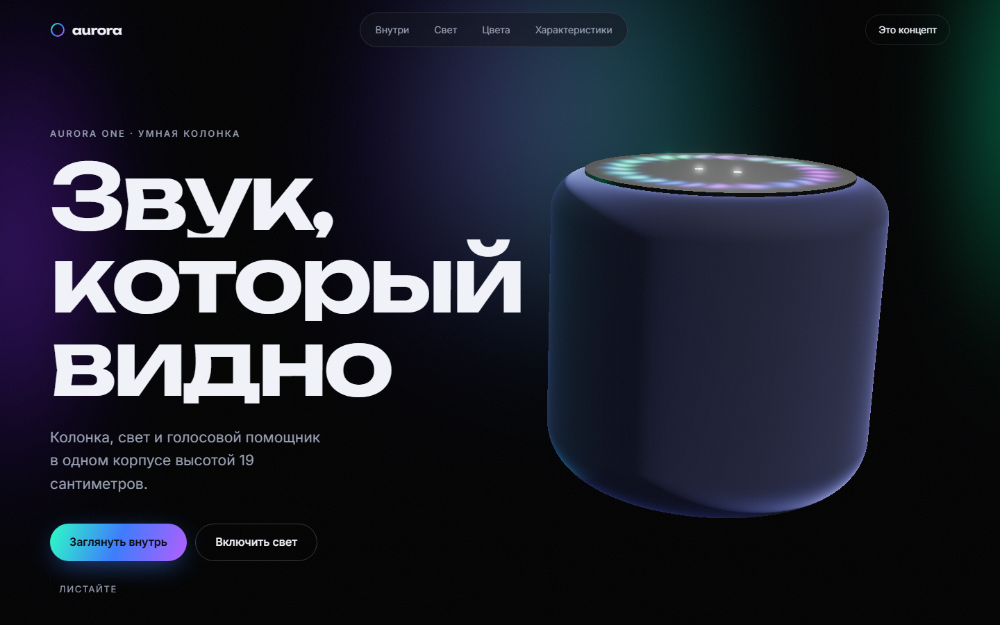
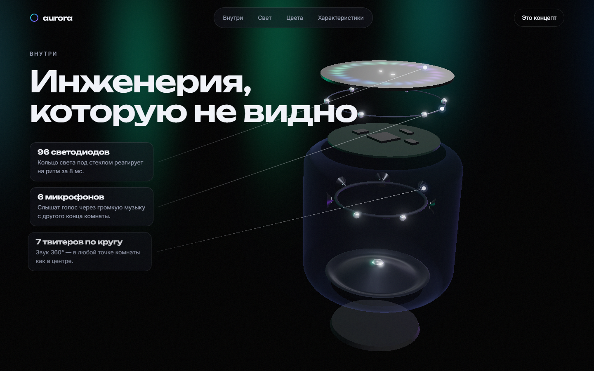

# Aurora One

[](https://github.com/Qwertyzxas/aurora/actions/workflows/ci.yml)

Концепт-лендинг вымышленной умной колонки в стиле работ с Awwwards. 3D-модель целиком построена кодом на Three.js, а прокрутка управляет сценой: колонка поворачивается, разбирается на детали и загорается.

**[▶ Открыть сайт](https://qwertyzxas.github.io/aurora/)**





> Aurora One — вымышленный продукт. Бренд, характеристики и цены придуманы для демонстрации.

## Что внутри

- **Процедурная 3D-модель без единого файла.** Корпус — тело вращения со скруглённым профилем, ткань — `MeshPhysicalMaterial` с отливом (sheen) и normal map плетения, которая считается математически при загрузке. Сабвуфер, рупоры твитеров, плата и микрофоны тоже собраны из примитивов.
- **Шейдеры.** Кольцо света — GLSL-шейдер «северного сияния» с HDR-яркостью под bloom. Фоновые «занавесы» сияния окрашены в ту же палитру и меняются вместе с режимом света.
- **Сцена, управляемая прокруткой.** Колонка меняет положение, поворот, степень разборки и яркость от секции к секции.
- **Взрыв-схема.** Секция закрепляется на экране, колонка разбирается, к деталям тянутся выноски. Линии пересчитываются каждый кадр по проекции 3D-точек на экран.
- **Анимации GSAP.** Сборка заголовка по буквам (SplitText), манифест, который «прочитывается» слово за словом, счётчик 16 777 216 оттенков, горизонтальная галерея сценариев, счётчики характеристик.
- **Плавная прокрутка Lenis**, синхронизированная с ScrollTrigger. Кастомный курсор и «магнитные» кнопки — только для мыши.
- **Интерактив.** Три режима света и три цвета ткани, материалы перекрашиваются плавно.

## Архитектура

```
src/
  content.ts        тексты и данные (выноски, режимы света, цвета, сценарии, характеристики)
  scene/
    state.ts        состояние сцены и чистые функции: sceneAt(), damp()
    Speaker.ts      процедурная модель, взрыв-схема, точки для выносок
    Stage.ts        рендерер, свет, bloom, проекция точек на экран, адаптация к экрану
    shaders.ts      GLSL: кольцо света и фон
    textures.ts     генерация normal map ткани
  anim/
    keyframes.ts    где должна быть колонка в каждой секции
    scroll.ts       ScrollTrigger, SplitText, закрепления, Lenis
  ui/interactions.ts  режимы света, цвета, навигация, курсор
```

### Ключевые решения

- **Сцена — чистая функция прокрутки.** Ключевые кадры привязаны к секциям через ScrollTrigger, а `sceneAt(frames, scrollY)` интерполирует между ними. Прокрутка назад всегда даёт ту же картинку, и логика покрыта юнит-тестами без браузера. Поверх работает сглаживание `damp()`, которое не зависит от частоты кадров.
- **Один WebGL-контекст на страницу.** Canvas фиксирован под контентом. Пока он скрыт за горизонтальной галереей, отрисовка пропускается.
- **Выноски строятся по модели, а не вручную.** Карточки стоят в обычной вёрстке, а точки и линии к деталям считаются из проекции 3D-якорей. Это пришлось развести осознанно: GSAP при анимации трансформаций сам сбрасывает CSS-свойство `translate`, поэтому позиционирование и анимация живут на разных элементах.
- **Порядок ScrollTrigger.** Триггеры ключевых кадров создаются после закреплений, чтобы их позиции учитывали дополнительную высоту закреплённых секций.

### Доступность и запасные режимы

- **`prefers-reduced-motion`.** Нет плавной прокрутки, закреплений и анимаций. Модель стоит неподвижно в первом экране, выноски показаны списком, весь текст сразу виден.
- **Без WebGL** вместо сцены показывается CSS-постер, а весь интерактив (цвета, режимы) продолжает работать.
- **Манифест**, который «проявляется» при прокрутке, с самого начала проходит WCAG AA по контрасту. Экранные читалки получают целую фразу, а не разбитые на слова фрагменты.
- Ссылка «Перейти к содержанию», семантические секции, перенос фокуса при переходах по меню.

## Тесты

| Уровень | Инструмент | Что проверяется |
| --- | --- | --- |
| Юнит | Vitest | интерполяция ключевых кадров, сглаживание, форматирование, согласованность контента с моделью |
| E2E | Playwright | загрузка без ошибок, выноски на модели во взрыв-схеме, режимы света и цвета, навигация, reduced motion, режим без WebGL, телефон без горизонтальной прокрутки |
| Доступность | axe-core | нет серьёзных нарушений WCAG 2 AA |

```bash
npm test
npm run e2e
```

## Запуск

```bash
npm install
npm run dev       # http://127.0.0.1:5176/aurora/
npm run build
```

## Стек

TypeScript (strict) · Three.js · GLSL · GSAP (ScrollTrigger, SplitText) · Lenis · Vite · Vitest · Playwright · axe-core

## Лицензия

Код — MIT. Бренд Aurora One вымышлен.
